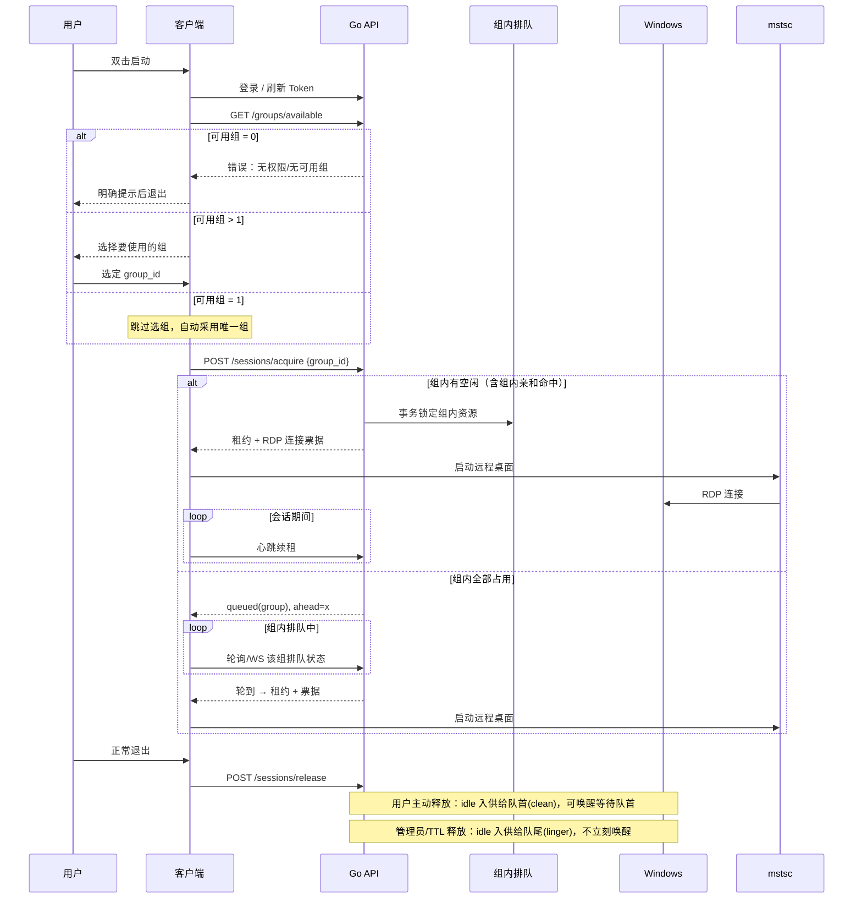
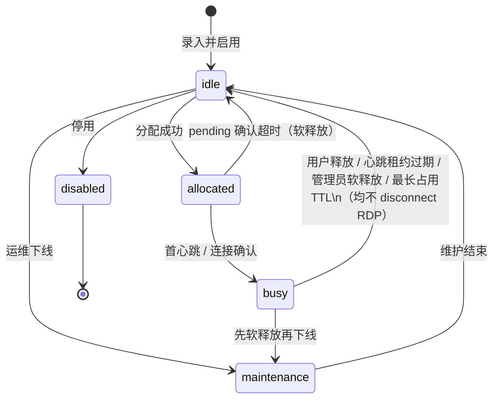
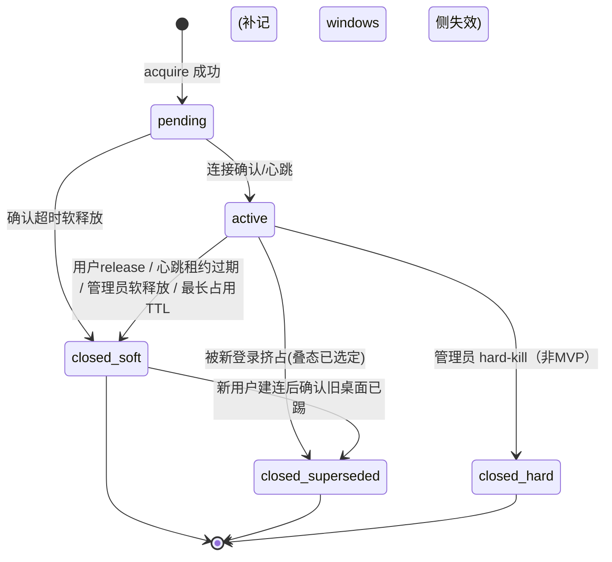
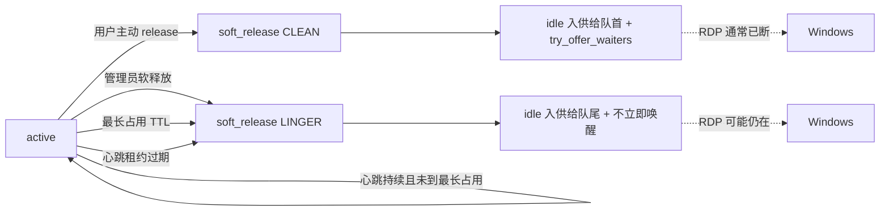
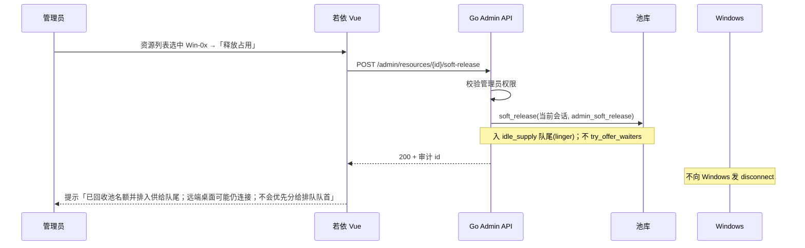

# Windows 远程桌面资源池 / 类堡垒机 — 技术架构设计

| 项 | 内容 |
|---|---|
| 文档版本 | 1.8 |
| 状态 | 可评审草稿 |
| 目标读者 | 产品、研发、运维、安全评审 |
| 范围 | n 台 Windows RDP 资源池 + m 用户（m>n）按需分配与排队 |
| 修订要点 | v1.8：叠态策略**已选定**——新 RDP 登录踢掉旧会话且旧池会话失效；与软释放/队尾关系已厘清 |

---

## 0. 一页纸摘要

**要解决的问题**：多用户共享少量、**按组划分**的 Windows 远程桌面机器；控制面保证每台**池侧**同时仅 1 个占用名额；用户登录后在授权组内一键连接；服务端负责分组、授权、组内分配/排队与（软）回收。

**已选定方案（MVP / 立项假设）**：

- **管理端架构（§2.2 已选定 A）**：**RuoYi-Vue + 保留 Go 池控制面**（不以若依 Java 重写调度；不用若依单体）
- **鉴权桥接（§2.3 已选定 1）**：**Nginx 路径分流 + 管理端双 Token**（非若依 Java BFF / 非统一网关）
- **RDP 接入（§2.4 已选定 A）**：**直连 + 控制面**——客户端持租约/票据后本地 `mstsc`/FreeRDP 直连 Windows；**控制面不转发像素**
- **池业务控制面**：**Go API** + **MySQL 8**（池库）+ Redis（**按组**排队与分布式锁）；与若依共用 MySQL 实例、分库名（见 §2）
- **管理后台**：**若依 RuoYi-Vue（前后端分离）**；含**资源组 CRUD**、**用户↔组授权**；业务页经 `/pool-api` 调 Go Admin API
- **资源分组**：Windows 划入多个 **Resource Group**；用户仅能访问被授权的组；分配/空闲判定/排队均在**用户所选组内**进行
- **客户端**：登录后按可用组数量分支——**>1 先选组**、**=1 跳过选组直接分配**、**=0 报错无权限**；再在组内走分配策略
- **分配策略（组作用域）**：组内亲和 → 否则按组内**空闲供给序**取机（clean 优先于 linger）→ 否则进入**该组等待用户队列**并展示 ahead=x
- **释放与入池优先级（v1.3 关键）**：一律软释放（标 idle、**不断开** RDP）。用户主动释放 → 供给**队首**(clean) 并可唤醒等待队首；管理员/TTL（及失联）→ 供给**队尾**(linger)，不立即唤醒。
- **叠态策略（§3.4 / v1.8 已选定）**：**新 RDP 登录踢掉旧会话，且旧池会话失效**。软释放阶段仍不断开；**真正踢人发生在新用户成功占用并建立（或即将建立）RDP 时**（Windows 单会话策略自动踢，或 claim/建连后辅助踢人）。

**核心不变量（池侧）**：每台 Windows 控制面最多 1 个占用中会话；每组并存两套序——**等待用户 FIFO** + **空闲资源供给序**。

**明确不做（MVP）**：Guacamole/像素代理、本期 RD Gateway、指定机预约、多协议、完整堡垒审计回放、**管理员主动 hard-kill API**（与「新登录踢旧」不同，见 §3.4）。

---

## 1. 总体架构与组件职责

### 1.1 架构图

```mermaid
flowchart TB
  subgraph Clients["用户侧"]
    C[Windows 客户端]
    M[mstsc / FreeRDP]
  end

  subgraph AdminUI["管理端 · 若依"]
    RV[RuoYi-Vue 前端]
    RJ[若依 Java<br/>系统管理/权限]
  end

  subgraph Portal["池控制面"]
    API[Go API<br/>分配/排队/租约/软释放]
    AUTH[终端用户认证]
    ALLOC[分配与排队引擎]
    REAPER[Reaper<br/>心跳租约 + 最长占用]
  end

  subgraph Data["状态层"]
    MY[(若依库 MySQL 8<br/>database: ruoyi)]
    MYPOOL[(池库 MySQL 8<br/>rdp_pool)]
    RD[(Redis)]
  end

  subgraph Pool["Windows 资源池（按组）"]
    G1[组 A]
    G2[组 B]
    W1[Win-01]
    W2[Win-02]
    Wn[Win-n]
    G1 --- W1
    G2 --- W2
    G2 --- Wn
  end

  C -->|HTTPS 登录/申请/心跳| API
  RV -->|/prod-api 系统管理| RJ
  RV -->|/pool-api + admin_token| API
  RJ --> MY
  API --> AUTH
  API --> ALLOC
  API --> REAPER
  ALLOC --> MYPOOL
  ALLOC --> RD
  REAPER --> MYPOOL
  C -->|租约+票据| M
  M -->|RDP 3389 直连(§2.4 已选定 A)| W1
  M --> W2
  M --> Wn
```

> **图注（立项）**：管理端走 §2.3 已选定桥接 1（Nginx 分流 + 双 Token）；RDP 像素路径为客户端直连 Windows，不经 Go/若依。


### 1.2 双击后时序（概览）



### 1.3 核心组件职责

| 组件 | 职责 | 非职责 |
|---|---|---|
| **Go API（池控制面）** | 终端用户认证、资源组、用户组授权、组作用域会话/排队、租约、软释放、票据、池审计 | 不转发 RDP 像素；不做若依菜单/RBAC 本体 |
| **分配引擎** | 组内：亲和 → `pick_idle`(clean>linger) → wait_queue；释放按 reason 入供给队首/队尾 | MVP 不做跨组调度 |
| **若依 RuoYi-Vue** | 管理员 UI：菜单、页面、按钮级权限展示 | 不实现分配算法 |
| **若依 Java** | 管理员账号、角色、菜单、部门、字典、操作日志等系统能力 | MVP 不重写池调度核心 |
| **客户端** | 配置、登录后选组（或跳过）、组内申请、拉起 RDP、心跳、**组内**排队展示 | 不内嵌完整 RDP 协议栈 |
| **池库** | 资源/会话/队列权威数据 | — |
| **若依库** | `sys_user` / `sys_role` / `sys_menu` 等 | 不存 RDP 票据明文 |
| **Redis** | 锁、**按 group_id 分片的排队 ZSET**、短期票据 | 非会话权威源 |
| **Windows 资源** | 提供桌面；**已选定**单会话：新登录踢旧 | 不实现业务分配 |
| **可选 Agent** | 探活；MVP 可用策略代替踢人；一期可补 claim 后强制注销 | 非管理员 hard-kill 控制台（一期） |

### 1.4 产品形态定位

本系统是**分组资源池控制面 + 轻量客户端 + 若依管理壳**，语义接近「按业务组分配远程桌面座位/类堡垒入口」。  
**§2.4 已选定 A**：RDP 为**客户端 ↔ Windows 直连**（同网/VPN，或经企业既有跳板/专线到达 3389）；控制面只发租约与连接票据，**不中转像素**（Guacamole / 自研代理本期未采纳）。

---

## 2. 推荐技术栈与选型

### 2.1 推荐组合（务实默认）

| 层级 | 推荐 | 理由 | 主要替代 |
|---|---|---|---|
| 池控制面 | **Go**（§2.2 **已选定 A**） | 分配锁/心跳/Reaper 并发简单；与若依解耦 | B：若依 Java 重写控制面（**未采纳**） |
| API 风格 | **REST + WebSocket（排队）** | 客户端与若依前端均可调用 | gRPC（内网再拆时） |
| 管理后台 | **若依 [RuoYi-Vue](https://doc.ruoyi.vip/ruoyi-vue/)**（前后端分离，**已选定**） | 现成菜单/RBAC/用户/字典；社区与文档成熟（官网：[若依文档](https://doc.ruoyi.vip/ruoyi/)） | C：若依单体 Thymeleaf（**未采纳**） |
| 若依系统后端 | **RuoYi-Vue 配套 Spring Boot** | 只管 `system` 模块 | RuoYi 不分离版（前后端一体） |
| 客户端 | **.NET 6+ WPF/WinUI** 或 **Tauri** | 与 mstsc 集成自然 | Electron |
| RDP 拉起 | **`.rdp` + `mstsc`** / FreeRDP | 零自研协议 | 内嵌 OCX（不推荐） |
| 池主库 | **MySQL 8.0+**（推荐 **8.0.x / 8.4 LTS**，需支持 `FOR UPDATE SKIP LOCKED`） | 与若依统一引擎；抢占用 InnoDB 行锁 + `SKIP LOCKED`（自 8.0.1 起） | PostgreSQL（仅当组织已有 PG 运维强约束） |
| 若依库 | **MySQL 8**（官方亦兼容 ≥5.7；本方案与池库对齐 8） | 开箱默认 | — |
| 缓存/锁/队列 | **Redis 7** | 锁、**按组**排队 ZSET、票据 TTL | 仅 DB（单机可） |
| 终端用户认证 | Go 侧 JWT（客户端） | 与管理员登录分离更清晰 | 统一走若依 Token（需网关改写） |
| 管理员认证 | 若依 Token / Session | 沿用脚手架 | — |
| 部署 | Compose：`ruoyi-vue` + `ruoyi-admin` + `go-api` + **单 MySQL 8（双 database）** + Redis | 一键起步 | K8s 后期 |

### 2.1.1 池库与若依库：同实例双 database（推荐）

| 方案 | 做法 | 评价 |
|---|---|---|
| **A. 同一 MySQL 8 实例，两个 database（推荐）** | 例：`ruoyi`（若依 `sys_*`）+ `rdp_pool`（池表）；账号可分权：`ruoyi_app` 仅 `ruoyi.*`，`rdp_app` 仅 `rdp_pool.*` | 运维一台库、备份一套；逻辑隔离清晰；Compose 最简单 |
| B. 两套 MySQL 实例 | 若依与池库物理分离 | 隔离更强，适合后期合规；MVP 成本高 |
| C. 同一 database 混表 | 池表与 `sys_*` 同库 | 备份/权限缠在一起，**不推荐** |

**推荐 A**。理由：本系统池控制面与若依本就进程分离，无需同 schema；同实例降运维；分 database 避免误改若依表、便于独立迁移池库。字符集统一 `utf8mb4`，排序规则建议 `utf8mb4_unicode_ci`（或与若依现网一致）。Go 与若依 JDBC 连接串指向不同 `database` 即可。

**版本要求**：池库 **MySQL ≥ 8.0.1**（正式建议用当前 8.0 维护版或 8.4）；必须 InnoDB。`SELECT ... FOR UPDATE SKIP LOCKED` 为官方支持的队列抢占写法。

### 2.2 若依路径：**已选定 A**（立项假设）

用户已拍板，以下为**既定架构**，不再作为待选项讨论。

| 方案 | 状态 | 做法 | 备忘 |
|---|---|---|---|
| **A. RuoYi-Vue + 保留 Go 控制面** | **已选定** | 若依负责系统管理；Vue「RDP 资源池」菜单调 Go `/api/v1/admin/*`（或 Nginx 反代）；终端客户端只调 Go；管理员鉴权打通见 §2.3 | 调度/租约/软释放在 Go；若依开箱 RBAC；两端并行 |
| B. 若依 Java 作唯一控制面 | **未采纳** | 分配/排队/租约全部写入若依业务模块 | 可作远期备忘，非 MVP、非本期立项 |
| C. 若依单体（Thymeleaf） | **未采纳** | 服务端渲染管理页 | 与 Go API 协作差 |

**立项结论（不可含糊）**：**已选定方案 A — RuoYi-Vue 前后端分离 + Go 池控制面**。  
B、C **明确不采纳**为本期实现路径；若未来组织强制「单 JVM」，须另立项评估，不得默认可替换 A。

### 2.3 业务模块如何挂到若依上

1. **菜单**：在若依「菜单管理」中新增目录「远程桌面资源池」，子菜单示例：
   - **资源组管理**、资源管理（归属组）、**用户组授权**、会话监控、**按组排队监控**、软释放、池配置（最长占用 TTL）、池审计
2. **权限字**：如 `rdp:group:list` / `rdp:group:edit` / `rdp:resource:list` / `rdp:resource:softRelease` / `rdp:user:grantGroup` / `rdp:config:edit`；按钮级 `v-hasPermi` 控制。
3. **前端工程**：在 RuoYi-Vue 的 `src/views/rdp/` 下建页面；`src/api/rdp/*.js` 封装对 **Go Admin API** 的请求。
4. **鉴权打通（§2.2 已选定 A 前提下；§2.3 已选定方案 1）**：

   | 方案 | 状态 | 说明 |
   |---|---|---|
   | **1. Nginx 路径分流 + 管理端双 Token** | **已选定** | 见下方落地要点 |
   | 2. 若依 Java BFF 转发 Go | **未采纳** | 可作远期备忘 |
   | 3. 共享网关统一签发 | **未采纳** | 可作远期备忘 |

   **落地要点（方案 1）**：

   - **Nginx 路径**：
     - `/` → 若依 Vue 静态资源
     - `/prod-api/` → 若依 Java（系统管理、登录、菜单、`sys_*`）
     - `/pool-api/` → Go API（资源池 Admin：组/资源/会话/软释放等）；对外可改写为上游 `/api/v1/admin/...`
   - **管理员登录顺序**：浏览器先调 `/prod-api` 完成若依登录，持有**若依 Token**；进入「RDP 资源池」菜单前/首次调池接口时，用若依身份向 Go 换取或并行持有 **`admin_token`**（推荐：`POST /pool-api/api/v1/admin/auth/exchange`，校验若依 Token 后签发短时 Go admin JWT；或 Go 配置若依 JWT 公钥直接校验——二选一实现，语义均为「管理员双凭证」）。
   - **前端双 Token**：若依请求头继续带若依 Token；凡 `src/api/rdp/*` 请求只带 **`Authorization: Bearer <admin_token>`**（可另加 `X-RuoYi-Token` 仅用于兑换，不把若依 Token 当作 Go 业务鉴权）。Axios 实例分离，避免拦截器串号。
   - **安全**：
     - **禁止**把终端用户（客户端）JWT 与管理员 `admin_token` / 若依 Token 混用或写入同一本地键。
     - `admin_token` 短 TTL、仅 admin 角色、HTTPS only；登出时两边一并作废。
     - Go Admin API 只认 `admin_token`（或已配置的若依管理员 JWT），不认 pool_user JWT。
5. **用户体系拆分**：
   - **管理员**：仅存若依 `sys_user`。
   - **终端用户（m）**：存池库 `pool_users`（Go 管理）；若依页提供 CRUD，写 Go API，**不要**把所有终端用户塞进若依登录态（避免污染后台账号模型）。可选：定时/手动从 AD 同步到 `pool_users`。
6. **字典与参数**：最长占用 TTL、确认窗、心跳 TTL 等可进若依「参数设置」表，Go 启动拉取或管理保存时双写到池库 `pool_settings`（**以池库为准**，避免调度读到脏配置）。

### 2.4 RDP 接入方式：**已选定 A**（立项假设）

| 方式 | 状态 | 说明 |
|---|---|---|
| **A. 直连 + 控制面** | **已选定** | 控制面签发短时租约 + 一次性连接票据；客户端本地 `mstsc`/FreeRDP **直连** Windows；**像素不经 Go/若依** |
| B. RD Gateway | **未采纳（本期）** | 微软 HTTPS 封装 RDP；公网受控进入时可另立项 |
| C. Guacamole / WebRDP | **未采纳** | 浏览器像素代理 |
| D. 自研 RDP 代理 | **未采纳** | 开发量大 |

**立项结论**：**已选定 A**。部署前提：用户客户端网络须能到达资源 **3389**（同网段、企业 VPN，或经**已有**跳板/专线——跳板属网络基础设施，不是本系统像素代理）。控制面仍只负责分配与票据，不中转桌面流量。

### 2.5 为何不用「纯文件/Excel 登记」

并发双开、排队、软释放审计均难保证；以 DB 事务为真相源。

---

## 3. 领域模型与资源状态机

### 3.1 核心实体

```text
ResourceGroup     资源组（名称、编码、启用、排序、说明）
Resource          Windows 机器（**group_id**、host、端口、池状态、标签、linger 提示）
PoolUser          终端用户（登录名、启用）
UserGroupGrant    用户↔组授权（user_id, group_id；多对多）
UserGroupAffinity 用户在某组内的上次资源（user_id, group_id, last_resource_id）
CredentialVault   资源侧凭据（加密）
Session           池侧占用（user、**group_id**、resource、状态、租约、软释放原因）
QueueEntry        排队项（**group_id**、user、seq、状态）——队列按组隔离
AuditLog          池审计（含组相关操作、软释放原因）
LeaseTicket       短时 RDP 连接票据
PoolSettings      全局配置（max_occupation_ttl_sec 等）
```

**约束**：

- 每台 Resource **必须**且仅属于一个 ResourceGroup（MVP 不支持一机多组）。
- 用户可见/可申请的组 = `UserGroupGrant` ∩ 组 `enabled=true`。
- 组内无机器或组停用 → 对该用户可不出现在「可用组」列表（或列出但标注不可用；**推荐：不出现**）。

若依侧实体（不重复建模）：`sys_user` / `sys_role` / `sys_menu` / `sys_oper_log` …

### 3.2 资源（Resource）池状态机



| 状态 | 含义 | 可被分配？ |
|---|---|---|
| `idle` | **池侧**空闲；仅对**本机组**的 acquire 可见 | 是（限本组） |
| `allocated` | 已分配、待客户端确认 | 否 |
| `busy` | 池侧占用中 | 否 |
| `maintenance` | 维护 | 否 |
| `disabled` | 停用 | 否 |

**字段补充（软释放风险与供给序）**：

- `linger_hint`（bool）、`last_soft_release_at`：列表标黄「可能仍有旧 RDP」。
- `supply_class`：`clean` | `linger`（仅在 `status=idle` 时有意义）。
- `supply_seq`：组内空闲供给序号（越大越靠后）；linger 入池取「当前最大 seq+1」，clean 入池取「当前最小 seq-1」或单独维护双堆——实现任选，语义为 **clean 整体优先于 linger**。
- **不**单独增加「半占用」池状态；叠态用 linger + 会话终态表达。

### 3.3 会话（Session）状态机



| 状态 | 含义 | 是否仍占坑 |
|---|---|---|
| `pending` / `active` | 池侧占用 | 是 |
| `closed_soft` | 池侧已结束；Windows RDP **当时**可能仍连着 | 否 |
| `closed_superseded` | 因**新用户登录/建连**导致旧桌面被踢；旧池会话明确失效 | 否 |
| `closed_hard` | 管理员主动硬踢成功（非 MVP） | 否 |

`close_reason` 枚举：`user_release` | `lease_expired` | `admin_soft_release` | `max_occupation_ttl` | `pending_timeout` | **`superseded_by_new_login`** | `admin_hard_kill`（非 MVP）。

### 3.4 叠态与踢旧：**已选定「新登录踢旧且旧会话失效」**

软释放后可能出现「池已 idle / 旧 RDP 仍连着」——这是软释放的预期副作用。用户已拍板叠态处理策略如下（相对「仅标 linger 碰运气」「拒绝第二连接」等：**后两者未采纳**）。

| 策略 | 状态 | 说明 |
|---|---|---|
| **新 RDP 登录踢掉旧会话，且旧池会话失效** | **已选定** | 新用户占用并建连时挤掉旧桌面；控制面将旧会话标为失效 |
| 仅 linger 提示、不保证踢旧 | **未采纳** | 叠态窗口不可接受 |
| 拒绝第二连接（旧用户霸占到其断开） | **未采纳** | 与资源入池再分配目标冲突 |

#### 与软释放 / 队尾的关系（必须同时成立）

1. **软释放（用户主动除外的 admin/TTL/失联等）仍不断开 RDP**——只把资源标 idle 并按 reason 入供给队首/队尾。  
2. **真正踢人推迟到**：新用户对该机 `acquire`/`claim` 成功，并**建立或即将建立**新 RDP 连接之时（由 Windows 单会话在新登录时自动踢，或建连流程中辅助注销）。  
3. 因此：admin/TTL **入供给队尾**降低「刚释放就立刻分给队首」的撞车频率；一旦必须分配 linger 机，则靠 **已选定踢旧策略** 收口，而不是让两人长期共桌。

#### MVP 实现要点（务实推荐路径）

**Windows 侧（MVP 主路径 — 组策略 / 本地策略，不依赖 Agent）**

1. 启用「将远程桌面服务用户限制为单独的远程桌面服务会话」（`fSingleSessionPerUser` / 相关 RDS 单会话策略）为 **Enabled**。  
2. 池内机器尽量使用**同一本地（或域）连接账号**发票据（当前 MVP 模型），使新登录与旧连接同用户，从而**新登录自动注销/断开旧会话**。  
3. 部署手册列为资源入池检查项；镜像预置策略。  
4. **备选增强（非必须）**：轻量 Agent / 计划任务在检测到新连接后对同机其它 session 执行 `rwinsta` / `logoff` / PowerShell `Stop-Computer` 以外的会话注销；或在 Go 收到新会话 `rdp_connected=true` 后经 WinRM 触发——**一期可加，MVP 以策略踢旧为准**。

**控制面**

1. 软释放时：旧会话 → `closed_soft` + 原 `close_reason`（如 `admin_soft_release`），资源 `linger_hint=true`。  
2. 新用户占用该资源且进入 `active`（或首次上报 `rdp_connected`）时：  
   - 写审计：`action=windows_session_superseded`，关联 `new_session_id` 与先前软释放的 `previous_session_id`（若有）。  
   - 将旧会话终态补记/更新为 **`closed_superseded`**，`close_reason=superseded_by_new_login`（若已是 `closed_soft`，允许终态升级为 superseded，保留原 soft reason 于 `meta_json.prior_close_reason`）。  
3. 若异常导致旧会话仍为 `pending`/`active` 而同资源又分配成功（互斥本不应发生）：强制 `soft_release`/`close` 旧会话，reason=`superseded_by_new_login`。  
4. **旧客户端感知**：  
   - 软释放后心跳已返回 **410**（会话失效）；  
   - 若用户未关客户端、RDP 仍开着：新用户登录后 Windows 踢线 → 客户端 RDP 断开；下次心跳或重连票据同样被告知已失效，提示「会话已被新占用取代，请重新申请」。

| 风险 | 说明 | 已选定处理 |
|---|---|---|
| 新用户连上与旧用户叠态 | 短暂同机窗口 | **新登录踢旧 + 旧会话 `superseded_by_new_login`** |
| 共享本地账密 | 同账便于单会话踢旧 | MVP 接受；增强期 JIT 用户 |
| 旧客户端仍心跳 | 池会话已失效 | Go 拒绝心跳/续票（410） |
| 管理员误判空闲 | linger 黄标 | UI `linger_hint`；踢旧在新占用时发生 |
| 管理员主动 hard-kill | 后台一键注销 | **仍非 MVP**（与「新登录踢旧」区分） |

### 3.5 排队状态

| 状态 | 含义 |
|---|---|
| `waiting` | 等待中 |
| `offered` | 已轮到，待 claim |
| `claimed` | 已转 Session |
| `canceled` | 取消 / offer 超时 |

### 3.6 亲和（按组）

`UserGroupAffinity(user_id, group_id, last_resource_id)`：该用户在**该组**内上次成功进入 `active` 的资源。

- acquire 时只读取**当前所选 `group_id`** 对应的亲和记录。
- 若 `last_resource_id` 已换组、停用、维护、非 idle 或不存在 → **忽略亲和**，在组内随机空闲。
- **用户主动释放**成功后：更新该 `(user, group)` 亲和。管理员/TTL 软释放是否更新亲和：MVP 建议**仍更新**（记录真实用过的机），但不影响供给队尾策略。

---

## 4. 分配与排队算法（语义 + 并发）

### 4.0 组内两套「队」（写死，避免混用）

每个 `group_id` 同时维护：

| 结构 | 成员 | 序 | 用途 |
|---|---|---|---|
| **等待用户队列** `wait_queue` | 排队中的用户 | FIFO | 算 `position` / `ahead`；被 offer 后 claim |
| **空闲资源供给序** `idle_supply` | `status=idle` 的机器 | **clean 队首优先，linger 队尾** | `acquire` / 唤醒时选哪台机 |

等待用户队列仍**按组独立**（相对全局单队列的理由同 v1.2）。  
下文「入队首 / 入队尾」若无特别说明，均指 **`idle_supply`（空闲资源供给序）**，不是把资源插进等待用户队列。

**同一用户跨组约束（MVP）**：全局至多一个 `pending`/`active`，或至多一个 `waiting`/`offered`。跨组申请 → 409 / 先取消排队。

### 4.0.1 释放原因 → 供给位置（v1.3）

| close_reason | 空闲供给位置 | 是否立即 `try_offer_waiters` | 说明 |
|---|---|---|---|
| `user_release` | **队首**（`supply_class=clean`） | **是** | 用户主动释放/正常断开，视为较「干净」 |
| `pending_timeout` | **队首**（clean） | **是** | 未真正建连，linger 风险低 |
| `admin_soft_release` | **队尾**（`linger`） | **否** | 管理员软释放；旧 RDP 很可能仍在 |
| `max_occupation_ttl` | **队尾**（linger） | **否** | 时长到期；同上 |
| `lease_expired` | **队尾**（linger） | **否** | 非用户主动断开，客户端失联，RDP 可能仍在 |

**为何队尾**：admin/TTL（及失联）软释放**不断开** RDP；入队尾优先消耗 clean，减少无谓踢人。linger 机最终仍可分配，此时依赖 §3.4 **已选定**的「新登录踢旧」收口，而非两人长期叠态。

### 4.0.2 两套队如何协作

```text
function pick_idle(group_id):
  // ORDER BY supply_class (clean<linger), supply_seq ASC
  // SKIP LOCKED 取一台

function try_offer_waiters(group_id):
  while wait_queue 非空 and pick_idle 成功:
    将资源 offered 给 wait 队首（claim TTL）

function on_resource_idle(resource, reason):
  标记 idle
  if reason in CLEAN:   // user_release, pending_timeout
    插入 idle_supply 队首 (clean)
    try_offer_waiters(resource.group_id)
  else:                 // admin_soft_release, max_occupation_ttl, lease_expired
    插入 idle_supply 队尾 (linger)
    // 明确：不在此刻 try_offer_waiters
```

**防饿死**：若长期只有 linger 空闲而 `wait_queue` 非空，由 **IdleOffer Reaper**（如每 15–30s）执行一次 `try_offer_waiters`——此时 `pick_idle` 仍会先 clean 后 linger，故仅在无 clean 时才会把队尾 linger 分给等待队首。这样既落实「admin/TTL 不入队首优先供给」，又避免等待者永久饿死。

### 4.1 分配语义（组作用域）

前置：客户端已选定 `group_id`。服务端校验 `UserGroupGrant`。

```text
function acquire(user, group_id):
  // 0) 授权；否则 403
  // 1) 幂等：已有 pending/active → 同组返回；跨组 409
  // 2) 组内亲和：affinity 资源若仍属本组且 idle → 尝试占用（不论 clean/linger）
  // 3) 否则 pick_idle(group_id)（clean 优先于 linger；同级可再随机打散）
  // 4) 无空闲 → 入 wait_queue(group_id)，返回 position / ahead
```

- `ahead = position - 1`（仅统计同组 waiting）。
- **禁止**在 `admin_soft_release` / `max_occupation_ttl` 路径上「释放完立刻把本机当队首 offer 给等待用户」。

### 4.2 并发一致性（MySQL 8）

InnoDB 行锁 + **`SELECT ... FOR UPDATE SKIP LOCKED`**（MySQL **8.0.1+**；候选集始终带 `group_id`）。示例：

```sql
START TRANSACTION;
SELECT id FROM resources
 WHERE group_id = ? AND status = 'idle' AND supply_class = 'clean'
 ORDER BY supply_seq ASC
 LIMIT 1
 FOR UPDATE SKIP LOCKED;
-- 若无 clean，再查 linger；更新 status / current_session_id 后 COMMIT
```

**占用互斥（MySQL 无 PG 式部分唯一索引）**，推荐二选一（语义不变）：

1. **生成列 + 唯一索引**（推荐）：如 `active_user_key` = `IF(state IN ('pending','active'), user_id, NULL)`，`UNIQUE(active_user_key)`；资源侧同理 `UNIQUE(active_resource_key)`。  
2. **旁路占用表**：`session_holds(user_id PK)` / `(resource_id PK)`，分配时插入、软释放时删除。

Redis：锁可选；排队 ZSET `queue:group:{group_id}`，**以 `rdp_pool.queue_entries` 为准可重建**。

### 4.3 两类 TTL：勿混淆

| 机制 | 作用对象 | 触发后行为 | 是否断 RDP |
|---|---|---|---|
| **心跳租约 `lease_expires_at`** | 客户端是否存活 | 过期 → 软释放，**idle 入供给队尾 (linger)** | **否** |
| **最长占用 `occupation_deadline_at`** | 墙上时钟上限 | 过期 → 软释放，**idle 入供给队尾 (linger)** | **否** |
| **pending 确认窗** | 分配后未首心跳 | 超时 → 软释放，**idle 入供给队首 (clean)** | **否** |
| **RDP 连接票据 TTL** | 一次性凭据 | 过期不可再取票 | 无关 |
| **新登录踢旧（§3.4 已选定）** | 新用户建连时 | Windows 单会话挤掉旧 RDP；池会话 → superseded | **是（对旧桌面）** |
| **管理员 hard-kill（非 MVP）** | 任意时刻后台踢 | Agent/`rwinsta` | **是** |

**心跳续期只延长 `lease_expires_at`，不延长 `occupation_deadline_at`。**  
最长占用从进入 `active`（或 `pending`，配置二选一；**推荐从 `pending` 创建时起算**，防占坑不连）开始计算。

### 4.4 软释放统一过程（入池优先级按 reason 分支）

```text
function soft_release(session, reason):
  事务:
    session.state = closed_soft
    session.close_reason = reason
    session.closed_at = now
    resource.status = idle
    resource.current_session_id = null
    resource.last_soft_release_at = now
    if reason in (user_release, pending_timeout):
      resource.supply_class = clean
      resource.linger_hint = false   // 或保持历史 hint 策略，推荐清
      place_idle_supply_head(resource)
    else:  // admin_soft_release | max_occupation_ttl | lease_expired
      resource.supply_class = linger
      resource.linger_hint = true
      place_idle_supply_tail(resource)
    // user_release 时更新 UserGroupAffinity
  然后:
    作废未用票据；拒绝后续 heartbeat
    if reason in CLEAN:
      try_offer_waiters(session.group_id)
    // LINGER：不在此处唤醒等待队首
    写审计（含 group_id, reason, supply_class, offered_waiters=bool）
```

管理员软释放与最长占用 Reaper **共用** `soft_release`，但 **supply 入队尾且不立即 offer**；与用户主动 `release` 的「入队首 + 可唤醒」区分开。**此处不断 RDP**；踢旧见 §3.4（新用户建连时）。

### 4.5 配置项

| 键 | 建议默认 | 说明 |
|---|---|---|
| `pending_confirm_sec` | 60–90 | 分配后未确认 |
| `heartbeat_interval_sec` | 15–20 | 客户端 |
| `lease_ttl_sec` | 45–60 | 心跳租约 |
| `max_occupation_ttl_sec` | 例如 4h～8h（0=关闭） | **全局**最长占用；可后续扩展到按资源覆盖 |
| `offer_ttl_sec` | 45–60 | 排队领取窗 |
| `ticket_ttl_sec` | 60–120 | 连接票据 |
| `linger_hint_ttl_sec` | 30min | 超时后自动清 hint（不表示 RDP 已断，仅降噪） |
| `linger_offer_scan_sec` | 15–30 | 仅 linger 空闲时，扫描 wait_queue 防饿死 |

### 4.6 边界情况

| 场景 | 处理 |
|---|---|
| 连点双击（同组） | 幂等返回已有会话 |
| 已有 A 组会话再申请 B 组 | 409，须先释放 |
| 亲和机不在当前组 / 非 idle | 忽略亲和，组内随机 |
| 可用组 = 0 | 客户端在选组前失败，不调用 acquire |
| 无授权却传 group_id | 403 |
| 软释放后旧用户再 acquire（同组） | 允许；若他人已占机则走正常分配；若己方旧 RDP 仍在，新登录踢旧（§3.4） |
| 管理员对 idle 机点释放 | 幂等成功，审计记 no-op |
| 最长占用与心跳同时到期 | 一次软释放；reason 优先 `max_occupation_ttl`（入**队尾**） |
| 管理员/TTL 释放时组内已有等待者 | 资源入 linger 队尾；**不**立即 offer；待 clean 释放或防饿死扫描再分配 |
| 组内仅有 linger 空闲 + 有等待者 | 防饿死 Reaper 才用队尾机 offer |
| 已有 active 想换机（同组） | MVP 拒绝，须先释放 |

---

## 5. 会话生命周期

### 5.1 主路径

登录 → **拉取可用组并选组（或跳过）** → `acquire(group_id)` →（组内 wait_queue / idle_supply）→ 票据 → mstsc → 心跳 → 用户 `release`（**clean 入供给队首**，可唤醒等待队首）。

### 5.2 异常与超长占用



### 5.3 阶段说明（修订后）

1. **登录 / 分配 / 启动 RDP / 心跳**：同前；选机走 `pick_idle`（clean 优先）。  
2. **用户释放**：`soft_release(user_release)` → **idle_supply 队首** + `try_offer_waiters`；更新组内亲和。  
3. **心跳 Reaper**：`soft_release(lease_expired)` → **队尾 linger**，不立即唤醒。  
4. **最长占用 Reaper**：`soft_release(max_occupation_ttl)` → **队尾 linger**，不立即唤醒。  
5. **管理员软释放**：`soft_release(admin_soft_release)` → **队尾 linger**，不立即唤醒；**不是**踢 RDP。  
6. **IdleOffer Reaper**：wait 非空且存在空闲时周期性 `try_offer_waiters`（防仅 linger 时饿死）。  
7. **新用户建连踢旧（§3.4 已选定）**：新会话 `active`/`rdp_connected` 时，Windows 单会话踢掉旧桌面；旧池会话标 `superseded_by_new_login`。  
8. **管理员 hard-kill API**：非 MVP。

### 5.4 管理员手动软释放流程



若依侧：按钮权限 `rdp:resource:softRelease`；二次确认须写明「不会断开对方 RDP，且该机进入组内空闲**队尾**」。

### 5.5 最长占用定时任务

- 进程：Go 内 Reaper（与心跳回收同一 worker，每 5–10s）。  
- 逻辑：到期 → `soft_release(max_occupation_ttl)` → **linger 队尾**，不立即唤醒等待队首。  
- 配置变更：新 TTL **不回溯**已有会话。  
- 另跑 IdleOffer 扫描（`linger_offer_scan_sec`）。  
- 监控：按 `close_reason` + `supply_class` 打点。

### 5.6 Windows 侧建议

- **必须启用单会话策略**（§3.4 **已选定**）：新 RDP 登录踢掉旧会话。  
- 防火墙限制 3389 来源。  
- 空闲锁屏可保留。  
- 软释放路径**不要**假设控制面会立刻断 RDP；踢旧绑定在**新占用建连**时刻。

---

## 6. API 与客户端交互流程

### 6.1 终端用户 API（Go）

| 方法 | 路径 | 说明 |
|---|---|---|
| POST | `/api/v1/auth/login` | 终端用户 JWT |
| POST | `/api/v1/auth/refresh` | 刷新 |
| GET | `/api/v1/groups/available` | 当前用户可用资源组列表（已授权且启用）；含 `id/name/idle_count?` |
| POST | `/api/v1/sessions/acquire` | body 必含 **`group_id`**；200 分配 / 202 组内排队 / 403 无权限 |
| GET | `/api/v1/sessions/current` | 当前占用（含 group_id） |
| POST | `/api/v1/sessions/{id}/heartbeat` | 续 **lease**；已 soft-closed 返回 410 |
| POST | `/api/v1/sessions/{id}/release` | 用户软释放 |
| POST | `/api/v1/sessions/claim` | 组内排队 offered 后领取（校验 group） |
| GET | `/api/v1/queue/me` | 当前排队的 `group_id`、position、ahead |
| DELETE | `/api/v1/queue/me` | 取消排队（换组前） |
| WS | `/api/v1/ws/queue?group_id=` | **该组**排队推送 |
| POST | `/api/v1/sessions/{id}/ticket` | 取 RDP 票据 |

### 6.2 管理 API（Go，供若依前端经 `/pool-api`；§2.3 桥接 1）

| 方法 | 路径 | 说明 |
|---|---|---|
| CRUD | `/api/v1/admin/groups` | **资源组**增删改查、启用/停用 |
| CRUD | `/api/v1/admin/resources` | 资源与维护；创建/变更时必填 **group_id** |
| POST | `/api/v1/admin/resources/{id}/soft-release` | **管理员软释放**（不断 RDP；**idle 入供给队尾**；不立即唤醒等待队首） |
| CRUD | `/api/v1/admin/pool-users` | 终端用户 |
| GET/PUT | `/api/v1/admin/pool-users/{id}/groups` | **用户可访问组**查询 / 覆盖式授权（`group_ids`） |
| GET | `/api/v1/admin/sessions` | 会话列表（可按 group 过滤） |
| GET | `/api/v1/admin/queues` | **按组**排队视图 |
| GET/PUT | `/api/v1/admin/settings` | 含 `max_occupation_ttl_sec` |
| GET | `/api/v1/admin/audit` | 池审计 |
| POST | `/api/v1/admin/resources/{id}/credentials` | 更新凭据 |

**刻意不在 MVP 提供**：`POST .../hard-kill`（管理员主动硬踢）。**新登录踢旧**不走该 API，而走 Windows 单会话 + 会话 superseded 审计。

### 6.3 soft-release 响应示例

```json
{
  "resource_id": "res_03",
  "previous_session_id": "ses_01H...",
  "close_reason": "admin_soft_release",
  "rdp_disconnected": false,
  "linger_hint": true,
  "supply_class": "linger",
  "idle_supply_position": "tail",
  "waiters_offered": false,
  "message": "池名额已释放并排入组内空闲供给队尾；未断开 RDP；未立即唤醒排队用户"
}
```

### 6.4 acquire 响应补充字段

```json
{
  "status": "allocated",
  "session": {
    "id": "ses_01H...",
    "group_id": "grp_cad",
    "group_name": "CAD设计组",
    "state": "pending",
    "lease_expires_at": "2026-10-21T17:10:00Z",
    "occupation_deadline_at": "2026-10-21T21:08:00Z"
  },
  "rdp_ticket": { "host": "10.0.2.13", "port": 3389, "username": "pooluser", "password": "...", "ticket_id": "tkt_..." }
}
```

### 6.5 `GET /groups/available` 响应示例

```json
{
  "groups": [
    { "id": "grp_office", "name": "办公桌面", "idle_count": 2, "busy_count": 3 },
    { "id": "grp_cad", "name": "CAD设计组", "idle_count": 0, "busy_count": 5 }
  ]
}
```

- `groups.length == 0` → 客户端展示：「当前账号没有可用的资源组，请联系管理员授权。」（区分「未授权」与「组均停用」，文案可统一为无可用组。）
- 排队响应须带 `group_id`，ahead 仅相对该组。

### 6.6 客户端双击完整流程（含选组）

1. 启动 → 读服务端 Base URL → 登录（DPAPI 存密码）。  
2. `GET /groups/available`：  
   - **0 个**：错误提示，结束。  
   - **1 个**：不展示选组 UI，`group_id = 该组`。  
   - **>1 个**：展示组列表供用户选择（可记忆上次所选组，但仍须在可用列表内）。  
3. `POST /sessions/acquire { group_id }`。  
4. **allocated**：拉起 mstsc + 心跳。  
5. **queued**：展示「本组前方还有 x 人」；WS/轮询；offered → claim。  
6. 用户释放 → soft release；清本地临时凭据。  
7. 心跳 410：提示名额已回收，建议断开后重新从选组/分配走起。

### 6.7 客户端其它行为

- 收到心跳 **410 / session_closed** 或 reason 含 `superseded_by_new_login`：提示占用已失效/被新登录取代；RDP 若仍开着通常已被 Windows 踢断，**客户端不必再强杀**。  
- 展示剩余最长占用时间（`occupation_deadline_at`）。  
- 换组：若正在排队，先 `DELETE /queue/me`。

### 6.8 若依管理端主流程

登录若依 → **资源组 CRUD** → 资源挂到组（状态 + linger）→ **终端用户组授权** → 维护模式 → 会话监控 → **按组排队** → **软释放** → 池配置（最长占用 TTL）→ 审计。

---

## 7. 安全设计

### 7.1 认证鉴权

- **终端用户**：Go JWT（`pool_user`）；仅客户端 → `/api/v1/...`（可经独立域名或同主机非管理路径）。  
- **管理员**：若依 RBAC（§2.2 **已选定 A**）+ §2.3 **已选定桥接 1**：浏览器持若依 Token + Go `admin_token`；池写操作只认后者。  
- **禁止混用**：终端用户 JWT ≠ 管理员 `admin_token` ≠ 若依 Token。  
- 软释放属高风险操作：权限字 + 二次确认 + 审计必记。  
- TLS 全站；票据与密码永不写若依操作日志明文。

### 7.1.1 网络与 RDP（§2.4 已选定 A）

- 客户端 → API：HTTPS。  
- 客户端 → Windows：**RDP 直连**（建议 NLA/CredSSP）；须保证到资源 `host:3389` 路由可达（办公网/VPN/既有跳板）。  
- **本期不做**经本业务服务端的像素中转；不把 3389 对公网裸奔暴露（防火墙/安全组收敛到来源网段）。

### 7.2 凭据保管

| 密钥 | 存放 |
|---|---|
| 终端用户密码 | 池库 Argon2id |
| 管理员密码 | 若依默认策略 |
| Windows RDP 密码 | 池库 AES-GCM，主密钥仅 Go 进程可读 |
| 客户端密码 | Windows DPAPI |

### 7.3 RDP 凭证下发

短 TTL 一次性票据；用后标记；日志打码。软释放后立即作废未使用票据。

### 7.4 审计（池侧必记）

登录成败、可用组查询、按组 acquire/排队/claim、票据签发、用户 release、lease_expired、admin_soft_release、max_occupation_ttl、**windows_session_superseded / superseded_by_new_login**、资源组/授权变更、维护、配置、凭据。  
字段：时间、操作者、资源、会话、`close_reason`、`prior_close_reason?`、`new_session_id?`、`rdp_disconnected`、IP。

若依 `sys_oper_log` 可记「谁点了按钮」；**业务真相以池审计为准**。

### 7.5 威胁与缓解（增补）

| 威胁 | 缓解 |
|---|---|
| 软释放后旧用户继续用机 | §3.4 **已选定**：新占用建连时踢旧；旧会话 superseded；心跳 410 |
| 管理员误释放 | 二次确认（含队尾语义）；审计；可后续加「释放冷却」 |
| 两套后台权限不一致 | 池写操作只认 Go 鉴权；若依菜单仅入口 |
| 越权选组 | acquire 强制校验 UserGroupGrant；禁用组不可出现在 available |
| 跨组抢队 | 队列与唤醒均带 group_id；禁止跨组 offer |
| admin/TTL 释放后立刻撞车 | linger 入队尾 + 不立即 offer；最终分配时 **新登录踢旧** |

---

## 8. 部署拓扑与容量 / 监控

### 8.1 单机起步（MVP）

```text
┌──────────────────────────────────────────────────────┐
│  Linux 主机                                           │
│  - nginx (TLS) §2.3 已选定桥接 1：                     │
│      /          → 若依 Vue                            │
│      /prod-api/ → 若依 Java（管理员登录/系统 API）      │
│      /pool-api/ → Go API（管理员双 Token 中的 admin_token）│
│  - ruoyi-admin (Java)                                  │
│  - go-api（终端用户 API + Admin API）                  │
│  - MySQL 8：`ruoyi` + `rdp_pool`                       │
│  - Redis                                               │
└──────────────────────────────────────────────────────┘
         │ HTTPS（控制面）
   管理员浏览器 ──双 Token──▶ nginx
   用户客户端 ──pool JWT──▶ go-api
         │
         │ RDP 3389 直连（§2.4 已选定 A）
         ▼
   Windows 资源池
```

Nginx 示意（节选）：

```nginx
location /prod-api/ { proxy_pass http://ruoyi-admin:8080/; }
location /pool-api/ { proxy_pass http://go-api:8081/; }
```

Compose 要点：§2.2 **已选定 A** + §2.3 **已选定桥接 1**；`ruoyi-vue` + `ruoyi-admin` + `go-api` + MySQL 8 双库 + Redis。  
**网络前提（§2.4 A）**：用户 PC 须能路由至各 Windows 的 3389（或经企业既有 VPN/跳板），与控制面 HTTPS 路径分离。

### 8.2 可扩展

- Go API 无状态水平扩展；若依按官方方式扩。  
- MySQL 8 主从（或若依与池库同实例主从）；Redis 哨兵。  
- 资源加机 = 插入 `resources`。

### 8.3 容量

并发占用上限 ≈ n；心跳 QPS 低；关注队列长度与软释放频率（TTL 过短会导致名额抖动）。

### 8.4 监控要点

- 资源按组 idle/busy、`supply_class=clean|linger` 数量  
- **每组 wait_queue 长度**、offer 超时、IdleOffer 扫描次数  
- 按 reason 分类的软释放（尤其入队尾的 `admin_soft_release` / `max_occupation_ttl`）  
- 心跳 410 比例（用户被回收后仍续命）  
- 若依与 Go 反向代理 5xx  

---

## 9. MVP 分期与后续扩展

### 9.1 MVP

- [x] **§2.2 已选定 A**：若依 Vue 挂载资源池菜单 + Go Admin API  
- [x] **§2.3 已选定桥接 1**：Nginx 分流 + 管理端双 Token  
- [x] **§2.4 已选定 A**：RDP 直连 + 控制面票据（不转发像素）  
- [x] **资源组 CRUD + 用户↔组授权**  
- [x] 客户端：可用组分支（选组 / 跳过 / 报错）+ 组内分配  
- [x] **按组独立排队** + ahead  
- [x] 组内亲和 → 随机空闲 → 排队  
- [x] 心跳租约 / 最长占用 / 管理员软释放（**linger 队尾**；用户释放 **clean 队首**）  
- [x] IdleOffer 防饿死扫描  
- [x] linger 提示与审计  
- [x] **§3.4 已选定**：新登录踢旧 + `superseded_by_new_login`；Windows 单会话入池检查  
- [x] Compose 部署说明（MySQL 8 双库）  

**可不做**：管理员 hard-kill API、一机多组、跨组统一队列、指定机型、预约、Web 桌面、AD/SSO、像素录屏/Guacamole、本期 RD Gateway；**§2.2 B/C、§2.3 桥接 2/3 本期不采纳**。

### 9.2 一期增强

- Windows Agent：探活 + claim 后强制注销补强 + 管理员 hard-kill  
- 按资源覆盖 max occupation；JIT 本地用户  
- （未采纳）若依 BFF 统一鉴权——当前为 Nginx+双 Token  
- 队列预计等待  

### 9.3 二期

- 指定机/预约、多协议、SSO、真堡垒录像、多租户  
- 仅当另立项且组织强制单栈时，才评估控制面迁入若依 Java（**非默认**；当前立项为 A）

---

## 10. 明确边界：不做什么

1. **§2.4 已选定 A**：不自研 RDP 协议栈 / 不经业务 API 中转像素；不以 Guacamole 替代直连。  
2. 不做通用 PAM 全功能。  
3. MVP 不裸奔对公网暴露 3389；客户端经内网/VPN/既有跳板到达资源。  
4. 不做复杂智能调度。  
5. 首期不做移动端 / macOS 客户端。  
6. Redis 非唯一真相源。  
7. **软释放不保证断开 RDP**；也不保证旧桌面进程被清理。  
8. **MVP 不做管理员 hard-kill API**；**已选定**新登录踢旧（Windows 单会话 / 建连时挤占），与 soft_release 不断开并行不悖。  
9. **§2.2 已选定 A**：不以若依单体（C）、不以若依 Java 重写控制面（B）作为本期方案。  
9b. **§2.3 已选定桥接 1**：不以若依 Java BFF、不以共享网关作为本期鉴权打通方案。  
10. 不为 n、m 规模做过度微服务拆分。  
11. **MVP 不做一机同时隶属多组**；不做全局混排队列。  
12. 不做「未选组就全池随机」的隐式分配。

---

## 附录 A. 建议表结构（池库 `rdp_pool`，MySQL 8）

引擎：**InnoDB**；字符集 **utf8mb4**。主键可用 `BIGINT` 雪花/号段，或 `CHAR(26)` ULID / `CHAR(36)` UUID 字符串（避免依赖 PG `uuid` 类型）。

```sql
-- 示意（非完整 DDL）
resource_groups(
  id VARCHAR(32) PRIMARY KEY,
  code VARCHAR(64) NOT NULL UNIQUE,
  name VARCHAR(128) NOT NULL,
  enabled TINYINT(1) NOT NULL DEFAULT 1,
  sort_order INT NOT NULL DEFAULT 0,
  created_at DATETIME(3) NOT NULL
);

pool_users(
  id VARCHAR(32) PRIMARY KEY,
  login VARCHAR(64) NOT NULL UNIQUE,
  password_hash VARCHAR(255) NOT NULL,
  enabled TINYINT(1) NOT NULL DEFAULT 1,
  created_at DATETIME(3) NOT NULL
);

user_group_grants(
  user_id VARCHAR(32) NOT NULL,
  group_id VARCHAR(32) NOT NULL,
  created_at DATETIME(3) NOT NULL,
  PRIMARY KEY (user_id, group_id)
);

user_group_affinities(
  user_id VARCHAR(32) NOT NULL,
  group_id VARCHAR(32) NOT NULL,
  last_resource_id VARCHAR(32) NOT NULL,
  updated_at DATETIME(3) NOT NULL,
  PRIMARY KEY (user_id, group_id)
);

resources(
  id VARCHAR(32) PRIMARY KEY,
  group_id VARCHAR(32) NOT NULL,
  name VARCHAR(128) NOT NULL,
  host VARCHAR(255) NOT NULL,
  rdp_port INT NOT NULL DEFAULT 3389,
  status VARCHAR(32) NOT NULL,           -- idle/allocated/busy/...
  tags JSON NULL,                       -- MySQL 8 JSON（非 jsonb）
  current_session_id VARCHAR(32) NULL,
  supply_class VARCHAR(16) NULL,        -- clean|linger，仅 idle 有意义
  supply_seq BIGINT NULL,
  linger_hint TINYINT(1) NOT NULL DEFAULT 0,
  last_soft_release_at DATETIME(3) NULL,
  created_at DATETIME(3) NOT NULL,
  KEY idx_resources_group_status (group_id, status),
  KEY idx_resources_supply (group_id, status, supply_class, supply_seq)
);

resource_secrets(
  resource_id VARCHAR(32) PRIMARY KEY,
  ciphertext VARBINARY(2048) NOT NULL,  -- 或 BLOB
  key_version INT NOT NULL,
  updated_at DATETIME(3) NOT NULL
);

sessions(
  id VARCHAR(32) PRIMARY KEY,
  user_id VARCHAR(32) NOT NULL,
  group_id VARCHAR(32) NOT NULL,
  resource_id VARCHAR(32) NOT NULL,
  state VARCHAR(32) NOT NULL,
  close_reason VARCHAR(64) NULL,
  lease_expires_at DATETIME(3) NULL,
  occupation_deadline_at DATETIME(3) NULL,
  client_instance_id VARCHAR(64) NULL,
  created_at DATETIME(3) NOT NULL,
  closed_at DATETIME(3) NULL,
  -- 占用互斥：生成列（示例）
  active_user_key VARCHAR(32)
    AS (IF(state IN ('pending','active'), user_id, NULL)) STORED,
  active_resource_key VARCHAR(32)
    AS (IF(state IN ('pending','active'), resource_id, NULL)) STORED,
  UNIQUE KEY uk_active_user (active_user_key),
  UNIQUE KEY uk_active_resource (active_resource_key),
  KEY idx_sessions_user_state (user_id, state)
);

queue_entries(
  id VARCHAR(32) PRIMARY KEY,
  group_id VARCHAR(32) NOT NULL,
  user_id VARCHAR(32) NOT NULL,
  status VARCHAR(32) NOT NULL,
  seq BIGINT NOT NULL,
  offered_resource_id VARCHAR(32) NULL,
  offered_until DATETIME(3) NULL,
  created_at DATETIME(3) NOT NULL,
  KEY idx_queue_group_status_seq (group_id, status, seq)
);

pool_settings(
  `key` VARCHAR(64) PRIMARY KEY,
  value TEXT NOT NULL,
  updated_at DATETIME(3) NOT NULL
);

audit_logs(
  id BIGINT PRIMARY KEY AUTO_INCREMENT,
  at DATETIME(3) NOT NULL,
  actor_type VARCHAR(32) NOT NULL,
  actor_id VARCHAR(64) NOT NULL,
  action VARCHAR(64) NOT NULL,
  target_type VARCHAR(32) NULL,
  target_id VARCHAR(64) NULL,
  meta_json JSON NULL,
  ip VARCHAR(64) NULL,
  KEY idx_audit_at (at)
);

rdp_tickets(
  id VARCHAR(32) PRIMARY KEY,
  session_id VARCHAR(32) NOT NULL,
  expires_at DATETIME(3) NOT NULL,
  used_at DATETIME(3) NULL,
  created_at DATETIME(3) NOT NULL
);
```

## 附录 B. 评审检查清单

- [ ] 管理端是否按 **§2.2 已选定 A（RuoYi-Vue + Go 控制面）** 落地，含资源组与用户授权菜单；未误走 B/C  
- [ ] 鉴权是否按 **§2.3 已选定桥接 1（Nginx + 双 Token）**；终端 JWT 与 admin_token 未混用  
- [ ] RDP 是否按 **§2.4 已选定 A（直连）**；客户端可达 3389；控制面未做像素代理  
- [ ] 叠态是否按 **§3.4 已选定**：新登录踢旧；旧会话 `superseded_by_new_login`；软释放仍不断开  
- [ ] 资源镜像是否启用 Windows 单会话策略（入池检查）  
- [ ] 客户端 0/1/>1 可用组分支是否与文档一致  
- [ ] acquire / 排队 / 亲和 / 空闲集合是否均限制在 **group_id** 内  
- [ ] 是否区分 **wait_queue** 与 **idle_supply**，且「队首/队尾」指空闲供给序  
- [ ] `user_release` / `pending_timeout` → clean 队首 + 可 `try_offer_waiters`  
- [ ] `admin_soft_release` / `max_occupation_ttl`（及 `lease_expired`）→ linger **队尾** + **不**立即唤醒  
- [ ] `pick_idle` 是否 clean 优先于 linger；防饿死扫描是否存在  
- [ ] 软释放共用函数且 **rdp_disconnected=false**  
- [ ] 心跳租约与最长占用分字段；越权组 403；管理员 hard-kill 不在 MVP  
- [ ] 审计含 `supply_class` / `waiters_offered`  
- [ ] 池库为 **MySQL 8.0+**，与若依分 database（推荐同实例 `ruoyi` + `rdp_pool`）  
- [ ] 抢占使用 `FOR UPDATE SKIP LOCKED`；占用互斥用生成列唯一索引或旁路表  

## 附录 C. 文档变更

| 版本 | 说明 |
|---|---|
| 1.0 | 初稿：总体架构、技术栈、状态机、分配一致性、生命周期、API、安全、部署、分期与边界 |
| 1.1 | 管理后台改为若依 RuoYi-Vue，明确与 Go 控制面整合；引入管理员软释放与最长占用 TTL；统一软释放语义并理顺与租约 Reaper 关系；强踢移出 MVP |
| 1.2 | 引入资源组与用户组授权；客户端选组交互（0/1/>1）；分配/亲和/排队均为组作用域；明确推荐按组独立队列；软释放语义保持不变 |
| 1.3 | 纠正入池优先级：用户主动释放入空闲供给队首并可唤醒等待队首；管理员/最长占用（及失联）入队尾且不立即唤醒；明确双队列协作与防饿死 |
| 1.4 | 池主库确定为 MySQL 8；推荐与若依同实例双 database（`ruoyi` + `rdp_pool`）；并发抢占与表类型按 MySQL 8 改写；业务语义不变 |
| 1.5 | §2.2 **已选定 A**（RuoYi-Vue + Go 控制面）为立项假设；B/C 标为未采纳；摘要/部署/鉴权/评审清单用语从「推荐」改为「已选定」 |
| 1.6 | 鉴权桥接 **已选定 1**：Nginx 路径分流 + 管理端双 Token；BFF/共享网关未采纳；落地要点写入 §2.3 |
| 1.7 | RDP 接入 **已选定 A**：直连 + 控制面（不转发像素）；网关/像素代理未采纳；网络前提与评审清单同步；与 v1.6 一并落盘 |
| 1.8 | 叠态策略 **已选定**：新 RDP 登录踢旧且旧会话 `superseded_by_new_login`；厘清与软释放不断开、admin/TTL 队尾的关系；Windows 单会话为 MVP 主路径 |
